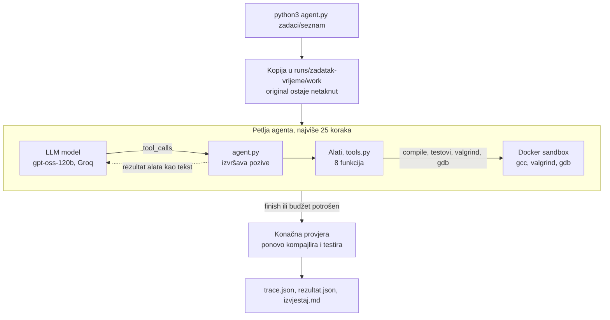
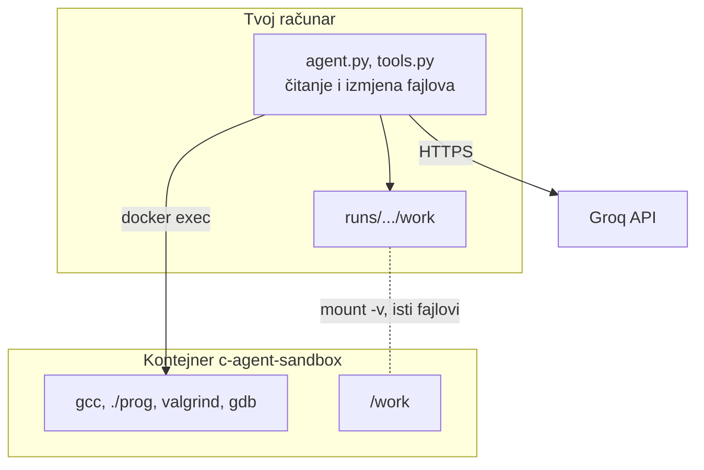
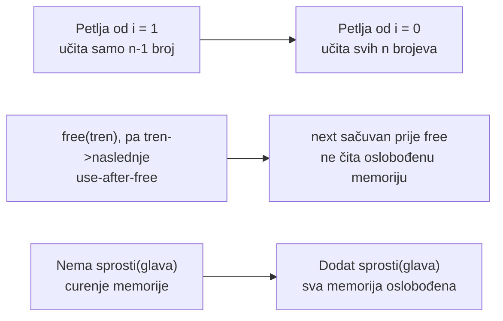

# c-debug-agent

Agent koji popravlja C programe dok ne prođu svi testovi. Pisan bez frameworka:
Groq API (tool calling) + Docker sandbox.

Uz agenta ide mali benchmark: šest zadataka s namjerno ubačenim bugovima i
`eval.py`, koji agenta pusti na sve zadatke i ispiše tabelu rezultata.

## Pokretanje

```bash
docker build -t c-agent-sandbox .
pip install -r requirements.txt
export GROQ_API_KEY=...
python3 agent.py zadaci/seznam
```

Ključ se uzima na [console.groq.com](https://console.groq.com). Model je `openai/gpt-oss-120b`.
Besplatni nivo ima mali limit tokena u minuti; ako iskoči, agent sačeka 30s i proba ponovo.

Svaki run se kopira u `runs/<zadatak>-<vrijeme>/` (original ostaje netaknut). Tamo
završe `trace.json` (svaki korak agenta), `rezultat.json` (testovi, koraci, tokeni)
i `izvjestaj.md` (sažetak za čitanje).

Svi zadaci odjednom:

```bash
python3 eval.py                 # svi zadaci u zadaci/
python3 eval.py zbroj neparni   # samo navedeni
```

## Kako radi



Dvije stvari rade zajedno, i nisu ista stvar:

- **Docker** je Linux kutija u kojoj se kompajlira i pokreće C. Unutra su `gcc`, `valgrind` i `gdb`. Nema interneta. Agentov kod ne može da ti sruši mašinu.
- **Groq** je servis koji vrati odgovor modela (`openai/gpt-oss-120b`). Model ne vidi tvoj disk i ne pokreće `gcc`. On samo kaže koji alat treba pozvati. `agent.py` taj alat stvarno izvrši.

Kad pokreneš `python3 agent.py zadaci/seznam`, redoslijed je ovaj:

1. Skripta kopira `zadaci/seznam/` u `runs/seznam-<vrijeme>/work/`. Original ostaje kakav jeste. Sve izmjene idu u kopiju.
2. Podigne se kontejner `c-agent-sandbox`. Folder `work` je unutra vidljiv kao `/work`.
3. Groqu se pošalje sistemsko uputstvo i tekst iz `TASK.md`.
4. Petlja, najviše 25 koraka. Svaki korak:
   - model vrati rečenicu (`[1] MISLI:`) i/ili zahtjev za alatom (`[1] ALAT:`);
   - `tools.py` izvrši alat (čitanje fajla je na disku, `compile` i testovi idu kroz Docker);
   - rezultat alata se vrati modelu kao sljedeća poruka.
5. Petlja stane kad model pozove `finish`, kad prestane zvati alate, ili kad potroši 25 koraka. Ako `run_tests` javi da sve prolazi, a model samo napiše tekst i ne pozove `finish`, petlja mu jednom kaže da pozove `finish`. Taj sažetak je ono što završi u `izvjestaj.md`.
6. Skripta sama obriše `prog`, ponovo kompajlira i ponovo pusti sve testove. Ne vjeruje modelu da je "gotovo".
7. U `runs/seznam-<vrijeme>/` upiše `trace.json`, `rezultat.json` i `izvjestaj.md`. Popravljeni kod je u `work/`. `trace.json` se upisuje poslije svakog koraka, ne tek na kraju. Ako Groq vrati `tool_use_failed` (model je poslao loš tool call), agent mu kaže da proba ponovo i nastavlja. Druga API greška prekida petlju, ali se trace, rezultat i izvještaj ipak upišu.

Ako terminal ispiše `Groq rate limit, čekam 30s...`, to je besplatni limit (oko 8000 tokena u minuti). Skripta čeka i nastavlja sama.

Svaki poziv modelu šalje cijelu historiju poruka ispočetka, pa ulazni tokeni rastu
brže od broja koraka. Zato `seznam` sa 10 koraka troši preko 20000 ulaznih tokena.

Alati koje model smije zvati:

| Alat | Šta uradi |
|---|---|
| `list_files` | lista fajlove u kopiji zadatka |
| `read_file` | pročita fajl s brojevima linija |
| `compile` | `gcc` sa AddressSanitizerom, napravi `./prog` |
| `run_tests` | pokrene `./prog` na svakom `tests/*.in` i uporedi s `.out` |
| `run_valgrind` | jedan test kroz Valgrind, za curenje memorije |
| `gdb_backtrace` | gdb na jednom testu, ako program padne |
| `replace_in_file` | zamijeni jedan tačan komad teksta. Fajlove u `tests/` odbija |
| `finish` | model kaže da je gotov i napiše sažetak |

Svaki alat vraća tekst, jer je to jedino što model vidi. Greške su napisane tako
da model zna šta dalje (npr. "kopiraj tačan tekst bez brojeva linija"), a dug
izlaz se skraćuje da se ne troše tokeni.

## Docker sandbox



Python i model razmišljaju i mijenjaju fajlove; Docker samo izvršava. Pokvaren C kod
se nikad ne pokreće direktno na tvom računaru. Drugi razlog za Docker je da su
alati isti na svakoj mašini: valgrind ne radi na novijem macOS-u, a Appleov
clang nema LeakSanitizer.

`sandbox.py` podigne jedan kontejner po runu (`sleep infinity`), svaka komanda ide
kroz `docker exec`, a na kraju se kontejner obriše.

| Zastavica | Zašto |
|---|---|
| `--network none` | bez interneta |
| `--memory 256m` | curenje memorije ne može pojesti više od 256 MB |
| `--pids-limit 64` | fork bomba odmah umre |
| `--user uid:gid` | ne radi kao root, fajlovi pripadaju tebi |
| `--cap-add SYS_PTRACE` | treba za gdb i LeakSanitizer |
| `--rm` | kontejner se sam obriše |

Svaka komanda ima `timeout` u kontejneru (test 5s, kompajliranje 60s) i još jedan
timeout u Pythonu. Model u oba slučaja dobije exit code 124 i poruku `TIMEOUT`.

## Struktura

| Fajl | Šta radi |
|---|---|
| `Dockerfile` | image `c-agent-sandbox`: Debian s `gcc`, `valgrind` i `gdb` |
| `sandbox.py` | Docker kontejner bez mreže, s limitom memorije/procesa i timeoutom |
| `tools.py` | Alati: `list_files`, `read_file`, `replace_in_file`, `compile`, `run_tests`, `run_valgrind`, `gdb_backtrace`, `finish` |
| `agent.py` | Agentska petlja, budžet koraka, logovanje, konačna provjera |
| `eval.py` | pusti agenta na sve zadatke i ispiše tabelu rezultata |
| `zadaci/<ime>/` | `main.c` s bugovima, `TASK.md`, `tests/*.in` + `*.out` |
| `primjeri/seznam/` | sačuvan jedan kompletan run: popravljen kod, trace, rezultat, izvještaj |

## Format zadatka

```
zadaci/seznam/
  TASK.md        opis zadatka
  main.c         program s bugovima
  tests/01.in    ulaz
  tests/01.out   očekivani izlaz
```

Test prolazi samo ako je izlaz isti **i** exit code 0, pa use-after-free i memory
leak (AddressSanitizer) ruše test čak i kad je izlaz tačan.

`compile` pravi `./prog` sa AddressSanitizerom. `run_valgrind` zato kompajlira
poseban binarni fajl u `/tmp` (valgrind i ASan se ne slažu) i vraća skraćen
izvještaj za jedan test. `gdb_backtrace` pokreće već kompajlirani `./prog` u
`gdb -batch` i vraća backtrace ako program padne.

## Benchmark

Svaki zadatak osim `seznam` ima tačno jedan ubačen bug, i bar jedan test koji ga hvata.

| Zadatak | Program | Ubačeni bug | Test koji ga hvata |
|---|---|---|---|
| `seznam` | lista, izbaci parne | 3 buga: petlja od `i = 1`, use-after-free, nema `sprosti` | svih 5 testova |
| `zbroj` | zbroj `n` brojeva | petlja počinje od `i = 1` | `n = 1` |
| `maksimum` | najveći od `n` brojeva | `maks = 0` na početku | samo negativni brojevi |
| `neparni` | koliko je neparnih | `x % 2 == 1` promaši negativne neparne | negativni neparni brojevi |
| `lista-duzina` | broj čvorova liste | petlja staje prije zadnjeg čvora | svaka lista |
| `lista-oslobodi` | ispis liste | `main` ne pozove `sprosti` | svaki test; izlaz je tačan, pada exit code |

### Rezultati

Puni `python3 eval.py`, model `openai/gpt-oss-120b`, 12. oktobra 2026
(`runs/eval-20261012-195535.json`). "Testovi" je konačna provjera harnessa, ne
ono što je model tvrdio.

| Zadatak | Testovi | Koraci | Tokeni (ulaz / izlaz) | Pozvao `finish` |
|---|---|---|---|---|
| `seznam` | 5/5 | 15 | 54346 / 2575 | da |
| `zbroj` | 2/2 | 8 | 9558 / 967 | da |
| `maksimum` | 2/2 | 20 | 38265 / 2631 | da |
| `neparni` | 2/2 | 9 | 10891 / 619 | da |
| `lista-duzina` | 2/2 | 11 | 22538 / 1025 | da |
| `lista-oslobodi` | 2/2 | 20 | 70077 / 11552 | da |
| **Ukupno** | **6/6** | | **205675 / 19369** | |

To nije jedini ishod. Isti dan je `eval.py zbroj` prvo dobio **0/2**: model je
poslije `compile` stao (`finish_reason=stop`) i nije pokrenuo testove. Raniji
ručni runovi, koji su prošli, bili su jeftiniji. `lista-oslobodi` je tada bio
7 koraka i 10617 / 476 tokena, ovdje 20 koraka i 70077 / 11552. Isti bug, isti
model, različit run.

## Šta radi, a šta ne

**Radi.** Petlja, sandbox i konačna provjera rade odvojeno od modela. Harness sam
kompajlira i testira, pa "sve prolazi" u tekstu ne ulazi u tabelu. Na jednom
bugu agent obično nađe liniju, zamijeni je i prođe testove za manje od 25 koraka.
`zbroj`, `neparni` i `lista-oslobodi` u ručnim runovima su bili jedna izmjena.
`seznam` je u jednom runu sredio sva tri buga. `eval.py` jednom zaredom dobije
6/6.

**Pada, i zašto.** Model nije stabilan. `zbroj` je jednom 2/2, a kroz `eval.py`
odmah zatim 0/2, jer je prestao zvati alate prije testa. Podsjetnik za `finish`
se pali samo ako je zadnji `run_tests` već `N/N`. Ako model stane ranije, petlja
ga ne gura dalje.

`maksimum` u ručnom runu od 11. oktobra je prošao testove, a zapis je loš.
Trebalo je jednu izmjenu. Model je `replace_in_file` zvao šest puta: jednom je
zamijenio `maks = 0` istim tekstom, jednom je obrisao `#include <stdio.h>`,
jednom je `old` bio tekst kojeg u fajlu nema. Na kraju je stavio `maks = INT_MIN`.
Za ove testove to jeste tačno (svaki `int` je veći od `INT_MIN`), ali nije ista
popravka kao uzeti prvi broj. Kad su testovi prošli, podsjetnik jeste upalio, a
model je sažetak napisao kao JSON u običnom tekstu i nije pozvao alat `finish`.
`izvjestaj.md` zato kaže da sažetka nema, iako rečenica postoji u terminalu. U
tabeli iznad, iz punog `eval.py`, `maksimum` jeste pozvao `finish`. Na `neparni`
i `lista-oslobodi` isti podsjetnik jeste završio pravim `finish` i u ručnom
runu. Jedan podsjetnik nije dovoljan kad model i dalje odgovara tekstom.

**Šta bih mijenjao.** Ako model stane a testovi još ne prolaze, petlja treba
jednom da kaže "nastavi, pokreni testove", ne samo kad su već prošli. Ako poslije
podsjetnika opet nema `finish`, sažetak iz tog teksta treba upisati u izvještaj,
da se ne izgubi. Stare rezultate alata treba skratiti: cijela historija ide u
svaki poziv, i zato jedan loš `lista-oslobodi` pojede 70000 ulaznih tokena.
Više zadataka dolazi poslije toga. Neće popraviti ni nestabilnost ni tokene.

## Ručna provjera u Dockeru nije isto što i `run_tests`

Agent testove traži samo u `tests/`. `01.in` pored `main.c` ne postoji za njega:
`run_tests` nađe nula testova i javi 0/0. Ista zamka je u ručnoj komandi
`./prog < tests/01.in`. Kod `lista-oslobodi` su ulazi prvo ležali pored `main.c`,
pa ni Docker ni agent nisu imali šta da pokrenu dok nisu pomjereni u `tests/`.

Druga rupa je sam `docker run` kad LeakSanitizer prekine program. `printf` drži
liniju u baferu. Proces umre prije nego što se bafer isprazni u fajl, pa
`/tmp/got` ostane prazan i `diff` izgleda kao da program nije ništa ispisao
(`-7 3 9 1` u očekivanom, ništa u dobijenom). Ispis je bio tačan. Pao je exit
code, zbog curenja. `diff` sam to ne pokazuje. Gledaj `EXIT:` i tekst
`LeakSanitizer`. Agentov `run_tests` hvata i izlaz i exit code; ručni `diff`
hvata samo fajl. Bez `--cap-add SYS_PTRACE` LeakSanitizer u jednokratnom
`docker run` ne mora raditi kao u sandboxu, koji tu zastavicu uvijek doda.

## Primjer: seznam

Jedan ručni run, `runs/seznam-20261011-132659`, sačuvan u `primjeri/seznam/`.
Model `openai/gpt-oss-120b`. Harness je sam potvrdio **5/5** testova, u 10 koraka
(22653 ulaznih tokena, 1437 izlaznih).



Tri izmjene u `primjeri/seznam/main.c`, original u `zadaci/seznam/main.c` je i dalje pokvaren:

1. U `odstraniSode` se `next` sačuva prije `free(tren)`, pa se petlja nastavlja sa `tren = next`.
2. Petlja čitanja je `for (i = 0; i < n; i++)`, tako da se pročita svih `n` brojeva.
3. `main` pozove `sprosti(glava)` prije `return`.

Original prolazi 0/5 testova (ASan prekine program), popravljena verzija 5/5.

U tom runu model je sažetak napisao kao običan tekst i nije pozvao `finish`,
pa `primjeri/seznam/izvjestaj.md` nema sažetak. Sažetak je u `trace.json`, korak 10.
Petlja sad na to jednom odgovori zahtjevom da se pozove `finish`.

## Dodavanje zadatka

Redoslijed je bitan, da benchmark ne vara sam sebe:

1. Napiši **ispravan** `main.c`, `TASK.md` i testove (`tests/01.in` + `tests/01.out`, ...).
2. Provjeri da ispravna verzija prolazi sve testove, u istom image-u i s istim flagovima kao agent.
3. Ubaci **jedan** bug.
4. Provjeri da bar jedan test sada pada. Ako sve i dalje prolazi, bug nije stvaran.
5. Obriši `prog` iz foldera zadatka i pokreni `python3 agent.py zadaci/<ime>`.
6. Pogledaj `rezultat.json` (`prosli` mora biti jednak `ukupno`) i uporedi
   `work/main.c` s originalom: treba biti izmijenjen samo bug.

Ručna provjera za korake 2 i 4:

```bash
docker run --rm --cap-add SYS_PTRACE --user "$(id -u):$(id -g)" \
  -v "$PWD/zadaci/zbroj:/work" -w /work c-agent-sandbox \
  gcc -Wall -Wextra -g -fsanitize=address,undefined -fno-omit-frame-pointer -o prog main.c
docker run --rm --cap-add SYS_PTRACE --user "$(id -u):$(id -g)" \
  -v "$PWD/zadaci/zbroj:/work" -w /work c-agent-sandbox \
  sh -c './prog < tests/01.in > /tmp/out; echo "exit $?"; diff -u tests/01.out /tmp/out'
rm zadaci/zbroj/prog
```

`--cap-add SYS_PTRACE` je bitan: bez njega LeakSanitizer u jednokratnom
`docker run` ne mora raditi kao u agentovom sandboxu. Ako sanitizer prekine
program, `diff` može pokazati prazan izlaz iako je `printf` bio tačan. Odluka je
`EXIT:`, ne sam `diff`. Detalj je iznad, u "Ručna provjera u Dockeru".

## Ograničenja

- **Budžet od 25 koraka.** Jedan bug košta 3 do 4 koraka (izmjena, `compile`,
  `run_tests`), pa program s puno grešaka može ostati nedovršen.
- **`read_file` reže fajlove duže od 8000 znakova** i zadrži početak i kraj. Bug u
  sredini dugog fajla agent ne vidi.
- **`run_tests` daje detalje samo za prva 3 pala testa.**
- **Agent nalazi samo ono što testovi hvataju.** Na primjer, `lista-duzina` bi pala za
  `n = 0`, ali nijedan test to ne provjerava.
- **Benchmark je mali i lak.** Šest zadataka, po dva testa, jedan run svaki, a bugove
  je ubacio isti autor koji je pisao testove. 6/6 pokazuje da agent rješava
  jednostavne slučajeve, ne gdje mu je granica.
- **Folder `work/` je u kontejneru upisiv.** Zabrana mijenjanja testova postoji samo u
  alatu `replace_in_file`; kompajlirani program bi u teoriji mogao prepisati `tests/`.
  Mount `tests/` kao read-only bi to zatvorio.
